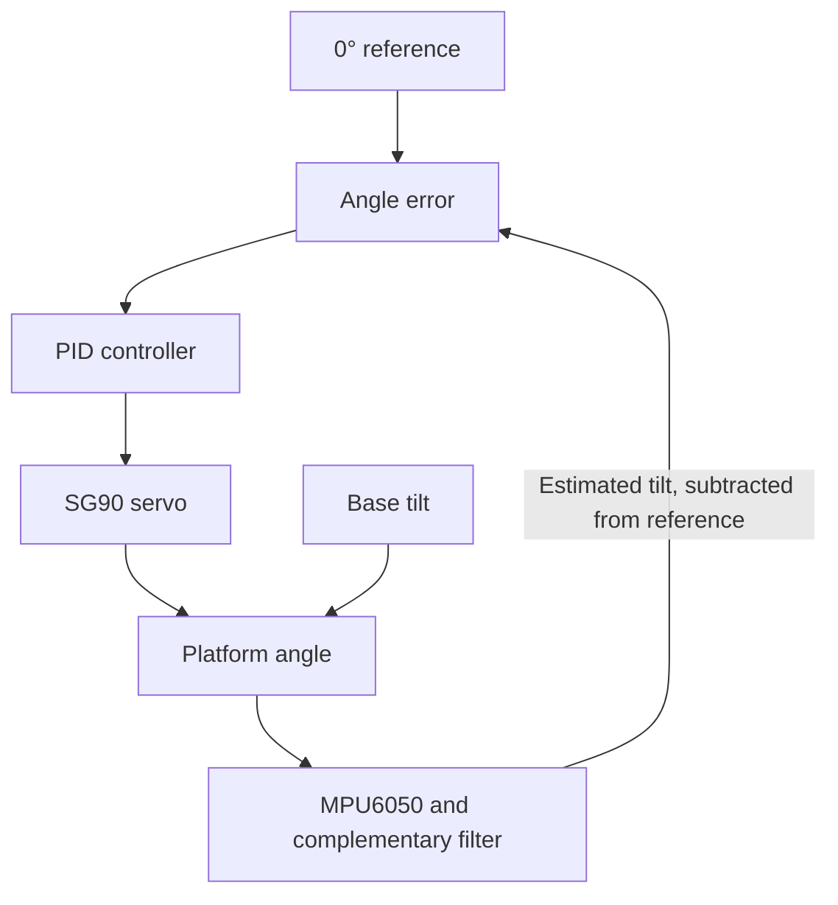

# PID Self-Leveling Platform

A single-axis feedback control system that keeps a hinged platform near horizontal when its base tilts. An **MPU6050** estimates platform tilt, a **PID controller** computes the correction, and an **SG90 servo** moves the platform toward the **0° setpoint**.

Developed as a group project for **IE3034 Control Systems Engineering** at the **Sri Lanka Institute of Information Technology (SLIIT)**.

## How the control loop works

The complementary filter blends the accelerometer's gravity-based tilt estimate with the gyroscope's short-term angular-rate information. The controller uses the resulting angle estimate as feedback. The servo drives the hinged platform about one axis.

| Component | Role |
| --- | --- |
| MPU6050 IMU | Measures acceleration and angular velocity over I²C |
| Microcontroller | Estimates tilt, computes PID output, and commands the servo |
| SG90 positional servo | Rotates the platform about the hinge |
| Hinged platform | Provides the single mechanical axis being controlled |

## Modeling and MATLAB results

The project uses a second-order plant model expressed in transfer-function and state-space form. The MATLAB tuning app described in the report compares proportional (P), proportional–integral (PI), and proportional–integral–derivative (PID) control on the same model.

| Controller | Kp | Ki | Kd | Rise time (s) | Overshoot | Settling time (s) | Steady-state error¹ |
| --- | ---: | ---: | ---: | ---: | ---: | ---: | ---: |
| P | 2.00 | 0 | 0 | 0.1062 | 24.95% | 0.6068 | 0.3333 |
| PI | 2.00 | 8.00 | 0 | 0.1297 | 14.88% | 1.0691 | 0 |
| **PID** | **2.00** | **8.00** | **0.15** | **0.2428** | **0%** | **0.7791** | **0** |

¹ Error is shown in the simulation's unit-step scale. These values come from the report's model with assumed plant parameters. The PID gains served as a starting point for tuning the physical prototype.

In simulation, PID eliminated the overshoot seen with P and PI and settled faster than PI. Its initial rise was slower than either controller.

## Hardware tests and limitations

| Test | Reported observation |
| --- | --- |
| Reference tracking (0° → 5° → 0°) | The prototype showed slight overshoot and took longer to settle than the model. Steady-state error was within measurement resolution. |
| Sudden base tilt | The platform returned to level after the base was tilted and held. Recovery took longer than the simulation predicted. |
| Repeated base tilt | The platform rejected slow disturbances more effectively than faster ones. |

The report describes the hardware results qualitatively. It attributes the differences from simulation to servo speed and torque limits, friction, gear backlash, and sensor effects.

## Repository contents

| File | Contents |
| --- | --- |
| [Project report](PID%20Self-Leveling%20Platform%20Report.pdf) | System design, mathematical models, MATLAB controller comparison, and prototype test methodology |

The original firmware, MATLAB project files, wiring schematic, and raw test logs are needed to reproduce the build and results. This repository currently contains the project documentation.

## Project inspiration

The mechanical concept was adapted from the [Science Buddies Auto-Leveling Platform](https://www.sciencebuddies.org/science-fair-projects/project-ideas/Robotics_p067/robotics/auto-leveling-platform). This implementation uses an MPU6050 for accelerometer–gyroscope sensor fusion.
